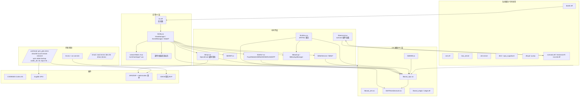

# 系统架构

A7M3 的软件栈可以分成 6 层。上层应用（菜单/拍摄）建立在 Sony 私有的
Appframework + 中间件之上，底层是 Linux 3.0.27 + 一堆相机专用内核模块。

## 结论速览

1. `/sbin/init` 是 Sony 自写的小型 init（28 KB），不是 BusyBox init：
   挂载 `/proc /sys /tmp /etc /setting /system /rootfs /usr /cert /log /lens`，
   加载 `/kmod` 与 `/usr/kmod`，启动 `bootin.elf`、`launch_shell.elf`、`sen.elf`
   （`net_cmdd.elf` 在 4.03 转储中不存在）。
2. `bootin.elf` 是启动阶段管理器：读 `/setting/mode/dmode` 与
   `/setting/mode/preload`，按 0–6（及 7/8/9/a/b/d/e/f/10 调试）阶段启动
   `im.elf`，可预加载 LeakTracer / Electric Fence / jemalloc / mcheckb。
3. `im.elf` 只是薄启动器：依赖 libIMDB / libosal / libbackup / libSTMcmdexecute，
   `dlopen("/usr/lib/libObj.so")` 加载应用框架，创建 `THREAD_APP` 与
   `THREAD_INFRA0..2`。
4. `libObj.so` 是应用框架核心（19 MB，1907 个导出符号）：`ViewManager`、
   `EventManager`、`Model*ToInstance`/`DefRootView`/`ScalarView`；
   菜单由 `viewUnified2..8.so` 与 `/usr/share/app/*.uxc` 描述。
5. 媒体栈是 `libmpr`（12 MB）：`MprLibCore` 提供拍照/回放/编解码/音频；
   底层依赖 `libclema`、`libsencore`、DSP 固件（`/usr/sabin/*.bin`）和
   编解码固件（`/usr/codec/*.bin`）。
6. 场景命令是插件机制：`scenario.elf` → `libtestcmd.so:testcmd_run_scenario()`
   → `dlopen("/usr/scenario/<NAME>.so")` → `scenario_run(data,size,arg2)`；
   工厂模块 `MPR_SCN_SET_FACTORY_MODE.so` 在这一层。
7. 服务化组件：`bsa_server`（蓝牙）、`orb-server`（远程/Web）、`dhd` +
   `wpa_supplicant`（Wi-Fi）、`dhcpd`/`pump`/`iptables`（网络）、
   `ulogio`/`ujlog`/`kikilog`（日志）、`sen.elf`（Senser）、`adjstctl.elf`（调整）、
   `libJiritsu.so`（JIRITSU）。

## 分层图



## 子系统

### 1. 启动与 init

| 文件 | 作用 |
|---|---|
| `/sbin/init` | Sony 自写 init：挂载分区、insmod、启动 bootin/launch_shell/sen |
| `/root/common.src` | updater 的挂载点/错误码/LED 函数库（被 FIRMUP 脚本 source） |
| `/usr/bin/bootin.elf` | 启动阶段管理器：读 `/setting/mode/dmode`，启动 `im.elf` |
| `/usr/bin/launch_shell.elf` | 调试 shell：`/dev/console` → `/bin/ash` |
| `/usr/bin/change_mode.sh` | 切换 0–10 启动/调试阶段 |
| `/usr/bin/up.sh` | 切换 updater 模式（UFP/版本跳过/MS crypt） |

详见 [BOOT-AND-INIT.md](BOOT-AND-INIT.md)。

### 2. OS 抽象 / IPC

| 库/工具 | 说明 |
|---|---|
| `libosal_uipc.so` | 用户态 IPC（消息队列、同步/异步消息、信号量、线程） |
| `libosal_utm.so` | 用户态定时器/线程管理 |
| `libSTMcmdexecute.so` | STM 命令执行（系统控制命令总线） |
| `libIMDB.so` | 内部消息数据库（IMDB_find_entry 等） |
| `libosal_ulogio.so` / `ulogio.elf` / `ujlog.elf` | 用户态日志 IO |
| `osal_uipc.ko` / `osal_ulogio.ko` / `osal_utm.ko` | 对应内核模块 |

多数 ELF 都直接依赖 `libosal_uipc`（70 个）与 `libosal_utm`（14 个），
说明它是整机进程间通信的基础。

### 3. Appframework（libObj）

`libObj.so` 19 MB、1907 个导出符号，是相机 UI/业务的核心：

- `ViewManager::getModelInfo`、`EventManager::push`、`LookManager::Create`；
- `DefRootView` / `ScalarView` / `ViewBase` 等视图基类；
- 大量 `Model*ToInstance`（LiveView、PostView、USB LiveView、NetHighlight、
  ScenarioClear 等）——模型/场景绑定；
- `blogEventSequence`（View/Model 事件序列）。

相关：

- `/usr/share/app/*.uxc`：视图/字符串/样式/图片定义（magic `uxc`，按语言拆分
  `string_*.uxc`）；
- `/usr/lib/viewUnified2.so` … `viewUnified8.so`：统一菜单视图库；
- `/usr/lib/CautionConfig.so`、`libSysDef.so`、`libmintx.so`：配置/系统定义/数学。

### 4. 媒体管线（MPR）

`libmpr.so`（12 MB）导出 `MprLibCore`：

- `AudioDecOpen/Start/Stop/Close`、`AudioPlayerPbStart`；
- `ParseStillImage` / `PlayStillImage` / `GetPictureSize` / `GetExifCarryData`；
- `DubLoadLib` / `DubPlayRec` / `FinDvdMenu`（回放/剪辑）；
- 依赖 `libInfraFsys`、`libInfraMediaDetect`、`libInfraMediaMount`、`libclema`。

底层：

- `/usr/sabin/*.bin`：DSP/加速器固件（AAC/AC3/JPEG/AVC/跟踪/降噪等，86 个）；
- `/usr/codec/*.bin`：BNI/BNL/VCD 编解码器固件；
- `/usr/kmod/codec_drv.ko`、`dma330.ko`、`accel.ko`、`stream*.ko`、`mcmn_drv.ko`。

### 5. Infra / 网络 / 存储

`/usr/lib/libInfra*.so` 是基础设施层：

| 前缀 | 作用 |
|---|---|
| `libInfraFsys` | 文件系统/挂载 |
| `libInfraMediaCommon/Detect/Mount` | 媒体检测/挂载 |
| `libInfraUsbCmn`、`libUsbControl` | USB 设备/模式 |
| `libInfraHdmi`、`libInfraDlnaControl`、`libInfraMtpServer` | HDMI/DLNA/MTP |
| `libInfraWebApi`、`libInfraRemoteControlNet` | Web API/远程控制 |
| `libInfraCacheMgr`、`libInfraBGMMeta`、`libInfraHighlight` | 缓存/BGM/高亮 |
| `libInfraMakeScenario` | 场景注册/生成 |
| `libNetService`、`libNetCommon`、`libNetRemote`、`libGOConnectionManager` | 网络服务/连接 |

服务进程：

- `orb-server`：远程控制/Web 后端（`WebApiLauncher.sh` 启动，端口 10000）；
- `bsa_server`：Broadcom 蓝牙协议栈（`startBTCore.sh`）；
- `dhd` + `wpa_supplicant` + `wifi-scripts/*`：Wi-Fi；
- `dhcpd`、`pump`、`iptables-multi`、`tcpdump`、`iperf`：网络配置/测试；
- `openssl`、`libssl/libcrypto`：TLS/证书。

### 6. 存储 / 备份 / 升级

- `/kmod/nand.ko`、`emmc.ko`、`ldec.ko`、`lld.ko`、`dmac.ko`、`devno.ko`：
  裸 NAND/eMMC/逻辑盘；
- `emmc.ko` + 分区表 → `/dev/nflasha1..25`；
- `libbackup.so` / `libBackupManager.so` / `backup.ko`：备份/恢复；
- `/setting/Backup.bin`、`/setting/updater/*`：备份与升级标志；
- `libJiritsu.so` + `/etc/jiritsu`：JIRITSU 文件/升级/调试/工厂协议；
- `udate.ko`、`upm.ko`、`usb_extcmd.ko`：升级/USB 扩展命令。

### 7. 传感器 / 镜头 / 显示

- `sen.elf`：Senser 服务（`/setting/.hasp`、`/setting/sen/smode`）；
- `adjstctl.elf`：调整控制（镜头/传感器）；
- `libsencore.so`、`libcompassutil.so`、`libutil_date.so`；
- `/lens/VX89xx_lensfile.bin`：镜头/像差数据；
- `grm_gles.ko`（GPU）、`grm_ma.ko`（媒体加速）、`dmm.ko`（显示内存）、
  `indctr.ko`、`input.ko`、`i2c.ko`、`mag.ko`、`compass.ko`；
- `viewUnified*.so` + `libObj` → Sugilite GPU 命令流。

### 8. 测试 / 场景命令

`libtestcmd.so` 是命令插件框架，三个入口：

| 入口 | 符号 | 用途 |
|---|---|---|
| `scenario.elf` | `testcmd_run_scenario` | 运行 `/usr/scenario/<NAME>.so` |
| `testcmd.elf` | `testcmd_sndmsg` | 发送测试命令 |
| `rcvcmd.elf` | `testcmd_rcvmsg` | 接收/分发测试命令 |

`/usr/scenario/*.so`（35 个）分三类：

- `AVBB_SCN_*`：音频/视频/HDMI/EVF/MIC 启停与参数；
- `CAMERA_SCN_*`：EE、脸部识别、录像、变焦、视频灯、外部 RAW；
- `MPR_SCN_*`：工厂模式、Wi-Fi 测试、格式化、日志、备份初始化、演示影片安装。

## 进程/服务一览

| 进程 | 路径 | 作用 | 启动者（推断） |
|---|---|---|---|
| init | `/sbin/init` | PID 1 | kernel |
| bootin | `/usr/bin/bootin.elf` | 启动阶段管理 | init |
| im.elf | `/usr/bin/im.elf` | Appframework 启动器 | bootin |
| sen.elf | `/usr/bin/sen.elf` | Senser 服务 | init |
| launch_shell | `/usr/bin/launch_shell.elf` | 调试 shell | init |
| bsa_server | `/usr/bin/bsa_server` | 蓝牙协议栈 | startBTCore.sh |
| orb-server | `/usr/bin/orb-server` | 远程/Web 服务 | WebApiLauncher.sh |
| dhd | `/usr/bin/dhd` | Wi-Fi 驱动 | wifi-scripts |
| wpa_supplicant | `/usr/bin/wpa_supplicant` | WPA | wifi-scripts |
| dhcpd | `/usr/sbin/dhcpd` | DHCP 服务 | 网络脚本 |
| ulogio | `/usr/bin/ulogio.elf` | 日志 IO | init/服务 |
| mpr_monio / mwf_monio | `/usr/bin/*.elf` | 中间件监控 | 调试 |
| scenario/testcmd/rcvcmd | `/usr/bin/*.elf` | 测试/场景 | 手动/服务 |

## 数据流

### 打开一个菜单视图

```
用户输入 → libObj EventManager → ViewManager::getModelInfo
        → Model*ToInstance → viewUnifiedN.so / .uxc 资源
        → 2D/GPU submit → grm_gles.ko → Sugilite GPU
```

### 执行一条 scenario 命令

```
scenario.elf <name> <size>:<data>
  → libtestcmd.so:testcmd_run_scenario()
  → dlopen("/usr/scenario/<name>.so")
  → scenario_run(data,size,arg2)
  → 模块内调用 MPR / Infra / Jiritsu / STM
```

### 拍照/回放

```
libObj 业务 → libmpr (MprLibCore) → libclema / libsencore
          → DMA330 / codec_drv / stream → DSP + /usr/sabin 固件
          → /system 或 /log 存储
```

## 边界

- 以上分层来自 NEEDED 依赖、导出符号和字符串，**未做逐函数动态跟踪**；
- “启动者”列中除 init 的显式字符串外，多为脚本/服务命名推断；
- `im.elf` 参数 `a/g/i/l/r/s/u` 的确切语义未解；
- `qsi.elf`、`net_cmdd.elf` 在 4.03 转储中不存在，可能属于 updater/其他机型；
- 不含 Sony 二进制，只保留分析结果。
