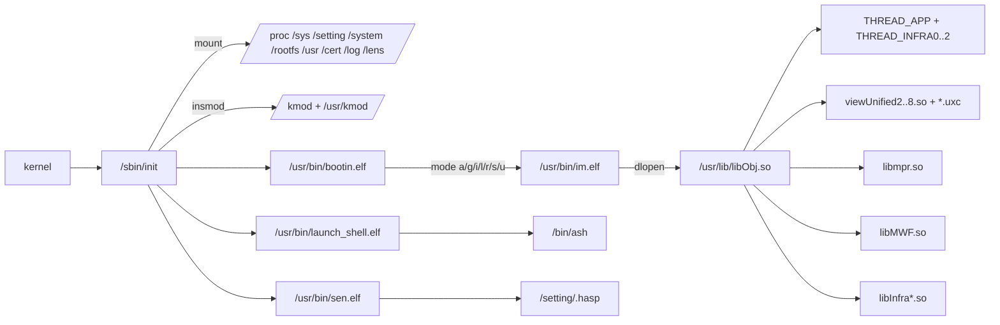
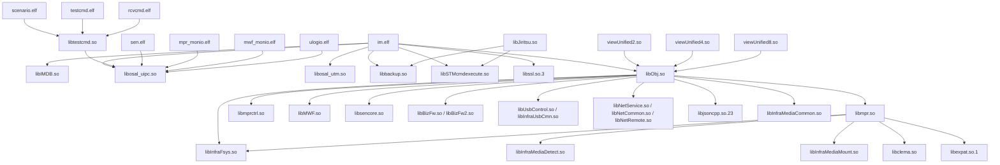
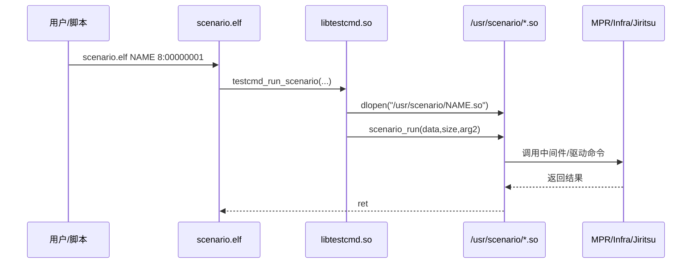

# 调用关系

调用关系分三类：

1. **进程启动关系**（init → bootin → im.elf → libObj）；
2. **ELF 链接依赖**（`data/deps.tsv`，1928 条 NEEDED 边）；
3. **插件/脚本调用**（scenario、testcmd、Wi-Fi/蓝牙脚本）。

## 1. 启动/进程关系

`bootin.elf` 的 `im.elf` 参数（a/g/i/l/r/s/u）来自字符串，语义未解；
`qsi.elf`、`net_cmdd.elf` 在 4.03 转储中不存在。

## 2. ELF 依赖图（关键节点）

> 只画了关键边；完整 1928 条边见 [../data/deps.tsv](../data/deps.tsv)。

## 3. 被依赖最多的库

| 库 | 被依赖次数 | 说明 |
|---|---:|---|
| `libc.so.6` | 346 | glibc |
| `libgcc_s.so.1` | 332 | GCC 运行时 |
| `libpthread.so.0` | 186 | 线程 |
| `libm.so.6` | 183 | 数学库 |
| `libdl.so.2` | 180 | dlopen |
| `libstdc++.so.6` | 175 | C++ 运行时 |
| `librt.so.1` | 174 | 实时扩展 |
| `libosal_uipc.so` | 70 | **Sony 用户态 IPC** |
| `libbackup.so` | 32 | 备份/恢复 |
| `libMWF.so` | 30 | MWF 中间件 |
| `dataflowInfraFramework.so` | 24 | 数据流框架 |
| `libcrypto.so.3` | 16 | OpenSSL |
| `libosal_utm.so` | 14 | 定时器/线程 |
| `libUsbControl.so` | 11 | USB 控制 |
| `libmpr.so` | 7 | 媒体管线 |
| `libNetCommon.so` | 7 | 网络 |
| `libInfraFsys.so` | 7 | 文件系统 |
| `libtestcmd.so` | 6 | 测试/场景 |
| `libSTMcmdexecute.so` | 6 | STM 命令 |

这说明整机不是“每个服务各自为政”，而是围绕 **osal/IPC + STM + backup + MWF**
构建的松耦合进程群。

## 4. Scenario/测试命令链

`scenario.elf` 的 CLI 还支持 `--ifile/--ibfile/--obfile/--ver`，对应
`cmdline_*` 符号；`testcmd.elf` 用 `testcmd_sndmsg` 发送，`rcvcmd.elf` 用
`testcmd_rcvmsg` 接收。

模块分类：

- `AVBB_SCN_*`（19 个）：音频/视频/HDMI/EVF/MIC 启停与设置；
- `CAMERA_SCN_*`（8 个）：EE、脸部识别、录像、变焦、视频灯、外部 RAW；
- `MPR_SCN_*`（8 个）：工厂模式、Wi-Fi 测试、格式化、日志、备份初始化、演示影片。

## 5. UI/菜单链

`libObj` 的导出符号里能直接看到 `ViewManager`、`EventManager`、
`DefRootView::ActionEventMapBase`、`ScalarView::Open` 等，说明菜单是
“View/Model/Event + uxc 资源”的数据驱动结构。

## 6. 脚本/服务调用

| 脚本 | 调用 |
|---|---|
| `/usr/bin/startBTCore.sh` | `bsa_server`（`/dev/ttyBT`，`bt_firm.hcd`） |
| `/usr/bin/WebApiLauncher.sh` | `orb-server -f /usr/share/network/remotecontrol -p 10000` |
| `/usr/wifi-scripts/start_dhd.sh` | `dhd` 驱动/固件 |
| `/usr/wifi-scripts/run_supplicant.sh` | `wpa_supplicant` |
| `/usr/wifi-scripts/setwifi.sh` | `wl` / `ifconfig` / `dhcpd`/`pump` |
| `/usr/bin/usb_insmod.sh` | `usb_event/usb_scd/ups/usb_otgcore/usb_gadgetcore/...` |
| `/usr/bin/up.sh` | 写 `/setting/updater/mode*`，影响下次启动 |
| `/usr/bin/change_mode.sh` | 写 `/setting/mode/dmode`、`preload` |
| `/usr/bin/bootin.elf` | 读 `dmode`/`preload`，启动 `im.elf` |

## 7. 证据

- `data/deps.tsv`：`readelf -d` 的 NEEDED 原始结果；
- `data/elf.tsv`：ELF 类型/机器/SONAME/依赖数；
- `docs/FILES.md`：每个文件的角色；
- `evidence/init-paths.txt`、`evidence/bootin-paths.txt`、`evidence/im-paths.txt`：
  启动相关字符串摘录；
- `evidence/scenario-cli.txt`、`evidence/change-mode-table.txt`、
  `evidence/libObj-view-symbols.txt`、`evidence/key-deps.txt`；
- 关键字符串：`init` 的 `/usr/bin/bootin.elf`、`/usr/bin/launch_shell.elf`、
  `/usr/bin/sen.elf`；`bootin.elf` 的 `/usr/bin/im.elf a &`；
  `im.elf` 的 `/usr/lib/libObj.so` 与 `THREAD_APP/THREAD_INFRA*`；
  `scenario.elf` 的 `testcmd_run_scenario`。

## 8. 未解/待验证

- `im.elf` 的 `a/g/i/l/r/s/u` 参数与 `dmode` 的精确映射；
- `libObj` 内部 View/Model 注册表与 `.uxc` 的加载顺序；
- `libJiritsu` 与 `/etc/jiritsu`、`/setting/.hasp` 的协议细节；
- `qsi.elf`、`net_cmdd.elf` 的缺失是版本差异还是按机型裁剪。
